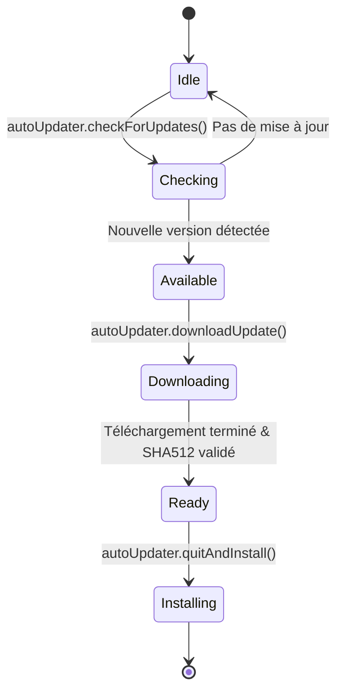

# Mises à Jour Automatiques (Auto-Update) — WEFLOW PNEUS

**Dépôt de Distribution** : [wellotek/WeFlow-Pneus-updates](https://github.com/wellotek/WeFlow-Pneus-updates)  
**Technologie** : `electron-updater` v6.6.2  
**Format de mise à jour** : Delta / Full Installer NSIS x64

---

## 1. Architecture de Distribution

La chaîne de publication sépare strictement le code source privé du canal de distribution public des installateurs et manifestes :

```
[Dépôt Source: wellotek/WeFlow-Pneus]
  │
  ├─> Build de Production: npm run electron:build
  │     └─> Génère:
  │           - WeFlow-Pneus-1.0.0-win-x64-setup.exe
  │           - latest.yml (contenant SHA512, taille, version)
  │
  └─> Publication sur [wellotek/WeFlow-Pneus-updates]
        └─> GitHub Release v1.0.0 (Assets: setup.exe + latest.yml)
```

---

## 2. Configuration d'Electron-Updater (`electron/services/appUpdater.ts`)

```typescript
autoUpdater.autoDownload = false
autoUpdater.autoInstallOnAppQuit = true
autoUpdater.setFeedURL({
  provider: 'github',
  owner: 'wellotek',
  repo: 'WeFlow-Pneus-updates'
})
```

---

## 3. Cycle de Vie d'une Mise à Jour



### 3.1. Détection
L'application interroge le fichier `latest.yml` sur GitHub Releases au démarrage puis toutes les 4 heures. Si la version distante est strictement supérieure à la version locale (selon SemVer vérifié par `isNewerVersion`), une notification visuelle apparaît dans la TopBar.

### 3.2. Téléchargement Contrôlé
L'utilisateur est averti via la modale `UpdateModal`. Le téléchargement s'effectue en arrière-plan avec affichage de la jauge de progression en pourcentage et du débit.

### 3.3. Contrôle d'Intégrité & Signature
Avant tout remplacement de binaire, `electron-updater` vérifie la somme de contrôle SHA-512 inscrite dans le manifeste signé `latest.yml`. Si la somme ne correspond pas, le paquet est immédiatement supprimé.

### 3.4. Installation
L'utilisateur peut cliquer sur **"Redémarrer et Installer"** immédiatement ou différer l'application de la mise à jour à la fermeture du logiciel.
