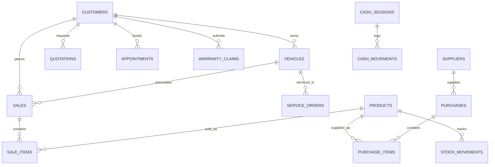

# Schéma de la Base de Données Locale — WEFLOW PNEUS

**Moteur** : SQLite 3 (`better-sqlite3` v11.10.0)  
**Emplacement** : `%APPDATA%/WeFlow Pneus/database.sqlite`  
**Configuration Moteur** :
- `PRAGMA journal_mode = WAL;` (Write-Ahead Logging pour lectures non-bloquantes)
- `PRAGMA foreign_keys = ON;` (Intégrité référentielle stricte)
- `PRAGMA synchronous = NORMAL;` (Haute performance et sécurité en cas de coupure)
- `PRAGMA busy_timeout = 5000;` (Tolérance aux accès concurrents)

---

## 1. Schéma Relationnel & Tables Principales

---

## 2. Description des Tables Métier

### 2.1. `products` (Catalogue & Stock Pneus)
- `id` (TEXT PRIMARY KEY) : UUID
- `reference` (TEXT UNIQUE) : Réf constructeur (ex: `MIC-2055516-E`)
- `barcode` (TEXT UNIQUE) : Code-barres EAN-13 ou Code 128
- `brand` (TEXT) : Marque (Michelin, Continental, Pirelli, Goodyear, Bridgestone...)
- `model` (TEXT) : Modèle de bande de roulement (Primacy 4, UltraContact, Cinturato P7...)
- `width` (INTEGER) : Largeur en mm (ex: 205)
- `aspect_ratio` (INTEGER) : Série / Hauteur en % (ex: 55)
- `diameter` (INTEGER) : Diamètre en pouces (ex: 16)
- `load_index` (TEXT) : Indice de charge (ex: 91)
- `speed_rating` (TEXT) : Indice de vitesse (H, V, W, Y...)
- `season` (TEXT) : summer, all_season, winter
- `vehicle_type` (TEXT) : passenger, suv_4x4, commercial, truck
- `purchase_price` (REAL) : Prix d'achat unitaire en DA
- `selling_price` (REAL) : Prix de vente unitaire en DA
- `current_stock` (INTEGER) : Quantité disponible en stock physique
- `min_stock_alert` (INTEGER) : Seuil minimal déclenchant l'alerte
- `location` (TEXT) : Rayonnage / Emplacement dépôt

### 2.2. `vehicles` & `vehicle_fitments`
- Gestion des véhicules par immatriculation algérienne et kilométrage.
- Table de correspondances techniques (`vehicle_fitments`) référençant les montes homologuées de constructeur (dimensions avant et arrière).

### 2.3. `sales` & `sale_items`
- Enregistrement transactionnel de chaque acte de vente.
- Calcul précis HT, TVA (19%), Remises, Mode de règlement (`cash`, `check`, `cib_edahabia`, `transfer`).
- Décrémentation automatique du stock et insertion dans `stock_movements`.

### 2.4. `cash_sessions` & `cash_movements`
- Suivi rigoureux du tiroir-caisse avec horodatage d'ouverture/fermeture, fond de caisse, et calcul des écarts de caisse lors de l'émission du Ticket Z.

### 2.5. `warranties`
- Réclamations constructeur, description du dommage, expertise atelier et statuts (`new`, `investigating`, `accepted`, `rejected`, `replaced`, `refunded`, `closed`).

---

## 3. Stratégie de Sauvegarde & Restauration

Le service `electron/services/backupService.ts` utilise l'API native SQLite Backup pour créer une copie cohérente sans interrompre les opérations en cours :
- Sauvegarde à chaud vers `%APPDATA%/WeFlow Pneus/backups/backup_YYYYMMDD_HHMMSS.sqlite`.
- Vérification de l'intégrité via `PRAGMA integrity_check;` avant toute validation de restauration.
